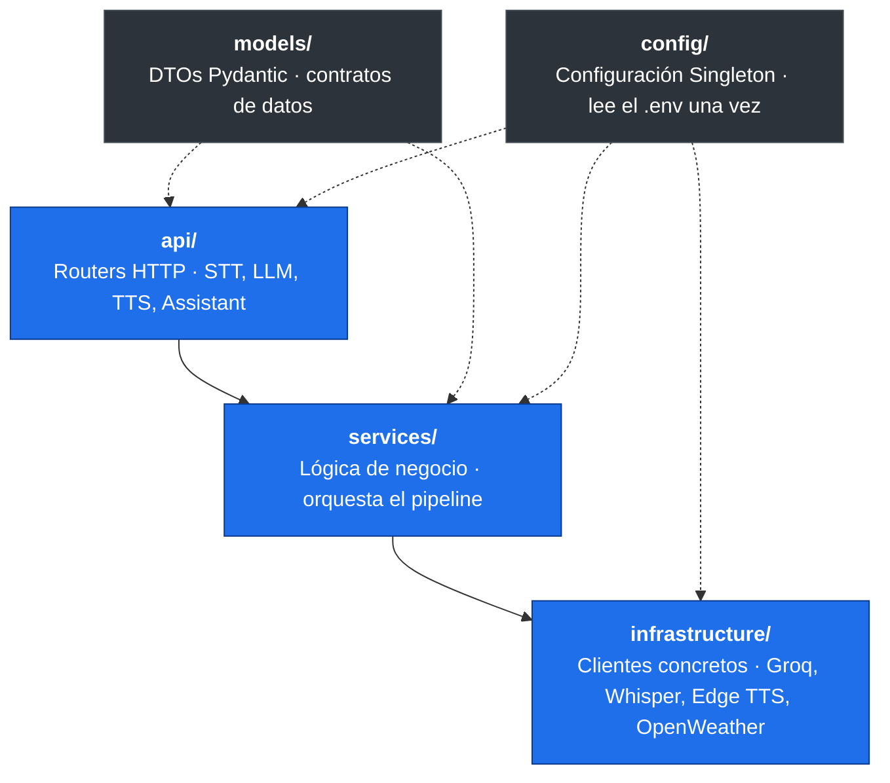

# it_ai_assistant: Mía, asistente de voz del hogar

Servidor del asistente de voz inteligente del proyecto **Inclusive Tech**, un sistema domótico accesible desarrollado como proyecto de grado en la Fundación Universitaria Konrad Lorenz.

Este servicio expone una API HTTP (FastAPI) que ejecuta el pipeline completo de voz: convierte el audio del usuario en texto (**STT**), lo interpreta con un modelo de lenguaje (**LLM**) para decidir una respuesta y una acción sobre la casa, y genera la respuesta hablada (**TTS**). La aplicación en Unity (`InclusiveTech_SmartHome`) es quien consume esta API.

---

## Tabla de contenidos

- [Características](#características)
- [Arquitectura](#arquitectura)
- [El pipeline de voz](#el-pipeline-de-voz)
- [Tecnologías](#tecnologías)
- [Estructura del proyecto](#estructura-del-proyecto)
- [Requisitos previos](#requisitos-previos)
- [Instalación](#instalación)
- [Configuración (archivo `.env`)](#configuración-archivo-env)
- [Ejecución](#ejecución)
- [Endpoints de la API](#endpoints-de-la-api)
- [Integración con Unity](#integración-con-unity)
- [Notas de operación](#notas-de-operación)
- [Solución de problemas](#solución-de-problemas)
- [Contexto académico](#contexto-académico)

---

## Características

- **Pipeline de voz completo** STT → LLM → TTS en un solo servicio.
- **Transcripción local** con `faster-whisper` (no depende de un servicio de nube para el STT).
- **Lenguaje natural** mediante la API de **Groq**, con detección de intención (conversación vs. acción del hogar).
- **Voz natural** con `edge-tts` (voces neuronales de Microsoft Edge).
- **Saludo matutino dinámico** que integra el nombre del usuario y el clima actual (OpenWeatherMap).
- **Arquitectura por capas** (API, servicios, infraestructura, modelos) con interfaces base para poder cambiar de proveedor sin tocar la lógica.
- **Medición de latencias** por etapa del pipeline, para diagnóstico de rendimiento.
- **Respuesta en una sola llamada:** el audio de respuesta viaja en el cuerpo y la acción del hogar en los headers HTTP.

---

## Arquitectura

El proyecto sigue una arquitectura por capas con inyección de dependencias de FastAPI. Cada capa tiene una responsabilidad única y depende de abstracciones (clases base), no de implementaciones concretas.



Patrones de diseño aplicados:

- **Singleton** — la configuración (`config/settings.py`) y los clientes pesados (modelo Whisper) se crean una sola vez al arrancar y se comparten vía `app.state`.
- **Observer** — el ciclo de vida de FastAPI (`lifespan`) carga recursos al iniciar y los libera al apagar.
- **DTO** — los modelos de `models/` definen el contrato exacto de datos entre Unity y el servidor.
- **Strategy / interfaces base** — `base_stt_client.py`, `base_llm_client.py`, `base_tts_client.py` permiten sustituir el proveedor sin cambiar los servicios.

---

## El pipeline de voz


1. **STT** — `faster-whisper` transcribe el audio a texto.
2. **LLM** — Groq interpreta el texto, decide si es una conversación o una **acción del hogar** (encender luz, abrir puerta, etc.) y redacta la respuesta.
3. **TTS** — `edge-tts` sintetiza la respuesta en un MP3.
4. La respuesta vuelve a Unity: el **MP3 en el cuerpo** y la **acción en los headers** (`X-Intent`, `X-Action-Type`, `X-Action-Room`, ...).

> Para reducir latencia, Unity suele transcribir por su cuenta y llamar directamente a `/assistant/process-text`, evitando reenviar el audio.

---

## Tecnologías

| Componente | Tecnología |
|---|---|
| Framework web | FastAPI + Uvicorn |
| STT (voz a texto) | faster-whisper (CTranslate2) |
| LLM (lenguaje) | Groq API |
| TTS (texto a voz) | edge-tts |
| Clima | OpenWeatherMap |
| Validación de datos | Pydantic v2 |
| Configuración | python-dotenv |
| Lenguaje | Python |

---

## Estructura del proyecto

```
it_ai_assistant/
├── api/                          # Capa de entrada: routers HTTP
│   ├── assistant_router.py       # Pipeline completo + saludo matutino + health
│   ├── stt_router.py             # Endpoints de transcripción
│   ├── llm_router.py             # Endpoints de lenguaje
│   ├── tts_router.py             # Endpoints de síntesis de voz
│   └── error_codes.py            # Códigos de error estandarizados
├── services/                     # Capa de lógica de negocio
│   ├── stt_service.py
│   ├── llm_service.py
│   ├── tts_service.py
│   ├── morning_routine_service.py
│   └── name_catalog.py
├── infrastructure/               # Capa de clientes concretos
│   ├── stt/                      # base + faster_whisper_client
│   ├── llm/                      # base + groq_client
│   ├── tts/                      # base + edge_tts_client
│   ├── weather/                  # openweather_client
│   └── metrics/                  # latency_log
├── models/                       # DTOs (Pydantic)
├── config/
│   └── settings.py               # Configuración centralizada (Singleton)
├── main.py                       # Punto de entrada del servidor
├── analyze_latency.py            # Script para analizar los logs de latencia
├── requirements.txt              # Dependencias
└── .env                          # Variables de entorno (NO se sube a git)
```

---

## Requisitos previos

- **Python 3.11 o superior** (recomendado 3.11 / 3.12).
- **pip** y **venv**.
- Una **API key de Groq** — https://console.groq.com
- Una **API key de OpenWeatherMap** — https://openweathermap.org/api
- Conexión a internet para el LLM (Groq), el TTS (Edge) y el clima. El STT (Whisper) corre en local.

> La primera vez, `faster-whisper` **descarga el modelo** indicado en `WHISPER_MODEL`. Hazlo con antelación antes de una demo para evitar la espera del arranque en frío.

---

## Instalación

```bash
# 1. Clonar el repositorio
git clone https://github.com/Gadex1506/it_ai_assistant.git
cd it_ai_assistant

# 2. Crear y activar el entorno virtual
python -m venv venv

# Windows
venv\Scripts\activate
# Linux / macOS
source venv/bin/activate

# 3. Instalar dependencias
pip install -r requirements.txt
```

> **Nota sobre `requirements.txt`:** el archivo está guardado en **UTF-16**. Si `pip install -r requirements.txt` falla con un error de codificación, vuelve a guardarlo como **UTF-8** (por ejemplo, abriéndolo en VS Code y eligiendo "Guardar con codificación → UTF-8") y repite el comando.

---

## Configuración (archivo `.env`)

Crea un archivo `.env` en la raíz del proyecto. **Nunca lo subas a git** (ya está en `.gitignore`).

```env
# ── Servidor ──────────────────────────────────────────────
SERVER_HOST=0.0.0.0
SERVER_PORT=8000

# ── Groq (LLM) — OBLIGATORIAS ─────────────────────────────
GROQ_API_KEY=tu_api_key_de_groq
GROQ_MODEL=llama-3.3-70b-versatile
GROQ_ENDPOINT=https://api.groq.com/openai/v1/chat/completions

# ── Whisper (STT) ─────────────────────────────────────────
WHISPER_MODEL=base

# ── Text-to-Speech ────────────────────────────────────────
TTS_DEFAULT_VOICE=es-CL-CatalinaNeural
TTS_DEFAULT_SPEED=+0%
TTS_DEFAULT_PITCH=+0Hz

# ── Identidad del asistente ───────────────────────────────
ASSISTANT_NAME=MÍA

# ── Clima (OpenWeatherMap) ────────────────────────────────
OPENWEATHER_API_KEY=tu_api_key_de_openweather
OPENWEATHER_CITY=Bogota
OPENWEATHER_COUNTRY_CODE=CO
OPENWEATHER_UNITS=metric
```

### Variables

| Variable | Obligatoria | Valor por defecto | Descripción |
|---|---|---|---|
| `SERVER_HOST` | No | `0.0.0.0` | Host donde escucha el servidor. |
| `SERVER_PORT` | No | `8000` | Puerto del servidor. |
| `GROQ_API_KEY` | **Sí** | — | Clave de la API de Groq. |
| `GROQ_MODEL` | **Sí** | — | Modelo de Groq a usar. |
| `GROQ_ENDPOINT` | **Sí** | — | Endpoint de la API de Groq. |
| `WHISPER_MODEL` | No | `base` | Tamaño del modelo Whisper (`tiny`, `base`, `small`, ...). |
| `TTS_DEFAULT_VOICE` | No | `es-CL-CatalinaNeural` | Voz de Edge TTS por defecto. |
| `TTS_DEFAULT_SPEED` | No | `+0%` | Velocidad de la voz. |
| `TTS_DEFAULT_PITCH` | No | `+0Hz` | Tono de la voz. |
| `ASSISTANT_NAME` | No | `MÍA` | Nombre del asistente. |
| `OPENWEATHER_API_KEY` | **Sí** | — | Clave de OpenWeatherMap. |
| `OPENWEATHER_CITY` | No | `Bogota` | Ciudad para el clima. |
| `OPENWEATHER_COUNTRY_CODE` | No | `CO` | Código de país ISO 3166. |
| `OPENWEATHER_UNITS` | No | `metric` | `metric` (°C) o `imperial` (°F). |

> Si falta alguna variable obligatoria, el servidor **no arranca** y muestra un error indicando exactamente cuál falta.

---

## Ejecución

```bash
# Con el entorno virtual activado
python main.py
```

El servidor queda disponible en `http://127.0.0.1:8000`. La documentación interactiva (Swagger) está en `http://127.0.0.1:8000/docs`.

Para comprobar que está en línea:

```bash
curl http://127.0.0.1:8000/
```

```json
{ "status": "online", "assistant": "MÍA", "version": "1.0.0", "docs": "/docs" }
```

> El arranque carga el modelo Whisper en memoria; en frío puede tardar. Unity contempla esta espera (timeout de arranque de 120 s para este servicio).

---

## Endpoints de la API

### General

| Método | Ruta | Descripción |
|---|---|---|
| `GET` | `/` | Estado del servidor (usado por Unity como health check). |
| `GET` | `/docs` | Documentación interactiva (Swagger UI). |

### Pipeline del asistente — `/assistant`

| Método | Ruta | Descripción |
|---|---|---|
| `POST` | `/assistant/process` | Pipeline completo desde **audio**: STT → LLM → TTS. Devuelve MP3 + acción en headers. |
| `POST` | `/assistant/process-text` | Pipeline desde **texto ya transcrito**: LLM → TTS. Más rápido (evita el STT). |
| `POST` | `/assistant/morning-greeting` | Saludo matutino dinámico con nombre de usuario y clima. |
| `GET` | `/assistant/health` | Estado de los tres subsistemas (STT, LLM, TTS). |

### Speech-to-Text — `/stt`

| Método | Ruta | Descripción |
|---|---|---|
| `POST` | `/stt/transcribe` | Transcribe un archivo de audio a texto. |
| `GET` | `/stt/languages` | Idiomas soportados. |
| `GET` | `/stt/health` | Estado del subsistema STT. |

### Language Model — `/llm`

| Método | Ruta | Descripción |
|---|---|---|
| `POST` | `/llm/chat` | Envía texto al LLM y obtiene respuesta/intención. |
| `POST` | `/llm/clear-history` | Limpia el historial de conversación. |
| `GET` | `/llm/health` | Estado del subsistema LLM. |

### Text-to-Speech — `/tts`

| Método | Ruta | Descripción |
|---|---|---|
| `POST` | `/tts/speak` | Sintetiza texto a audio (MP3). |
| `GET` | `/tts/voices` | Voces disponibles de Edge TTS. |
| `GET` | `/tts/health` | Estado del subsistema TTS. |

### Headers de respuesta de la acción del hogar

`/assistant/process` y `/assistant/process-text` devuelven el audio en el cuerpo y la intención/acción en los headers (los textos van codificados en URL para conservar tildes y la `ñ`):

| Header | Descripción |
|---|---|
| `X-Intent` | Intención detectada (conversación o acción del hogar). |
| `X-Response-Text` | Texto de la respuesta (URL-encoded). |
| `X-Action-Type` | Tipo de acción (solo si es acción del hogar). |
| `X-Action-Room` | Habitación objetivo (URL-encoded) o `null`. |
| `X-Action-State` | Estado deseado (p. ej. encender/apagar) o `null`. |
| `X-Action-Value` | Valor numérico de la acción o `null`. |

---

## Integración con Unity

Este servicio es uno de los tres procesos que la app de Unity levanta automáticamente al arrancar (vía su `ProcessManager`). El contrato que debe cumplir:

- **Arranque:** `python main.py` desde la carpeta del servicio (con el `python.exe` del venv).
- **Puerto:** `8000`.
- **Health check:** Unity hace `GET http://127.0.0.1:8000/` y lo da por listo cuando responde `2xx`. **Timeout de arranque: 120 s** (por la carga del modelo Whisper).
- **Variables inyectadas por Unity:** `PYTHONUNBUFFERED=1` y `PYTHONUTF8=1`.
- **Apagado:** Unity termina el proceso de forma forzada (árbol completo). El servidor limpia los audios temporales en el evento de apagado.

> Para la demo y el build, deja `reload=False` (ya está así en `main.py`): el modo `--reload` de uvicorn lanza un proceso recargador aparte que complica el apagado por árbol.

---

## Notas de operación

- **`temp_audio/`** — se crea al arrancar y se limpia (archivos `.mp3`/`.wav`) al apagar. No se versiona.
- **Logs de latencia** — el pipeline mide cada etapa; `analyze_latency.py` ayuda a revisar esos registros. Desactiva el log de latencias para la demo si no lo necesitas.
- **Modelo Whisper** — se descarga la primera vez. En el portátil de la sustentación, pre-descárgalo y considera excluir la carpeta del antivirus para que el primer arranque no sea lento.
- **Manejo de errores** — las excepciones no controladas devuelven un JSON consistente con código 500 en lugar del error genérico de FastAPI.

---

## Solución de problemas

| Síntoma | Causa probable | Solución |
|---|---|---|
| El servidor no arranca y pide variables | Falta una variable obligatoria en `.env` | Revisa `GROQ_API_KEY`, `GROQ_MODEL`, `GROQ_ENDPOINT`, `OPENWEATHER_API_KEY`. |
| `pip install -r requirements.txt` falla por codificación | `requirements.txt` está en UTF-16 | Vuelve a guardarlo como UTF-8 y reintenta. |
| Primer arranque muy lento | Descarga/carga del modelo Whisper | Pre-descarga el modelo; usa un tamaño menor (`tiny`/`base`) si hace falta. |
| Tildes o `ñ` corruptas en Unity | Decodificación de headers | Los textos van URL-encoded; Unity debe decodificarlos (ya contemplado). |
| El puerto 8000 queda ocupado tras cerrar | Proceso Python huérfano | Verifica que no queden `python.exe` colgados; libera el puerto 8000. |

---

## Contexto académico

Proyecto de grado **Panitas: Inclusive Tech** — Fundación Universitaria Konrad Lorenz.
Sistema domótico accesible compuesto por el asistente de voz (`it_ai_assistant`), la palabra de activación (`it_wake_word`), el sistema de navegación (`it_nav_system`) y el reconocimiento facial, integrados en la aplicación de Unity `InclusiveTech_SmartHome`.